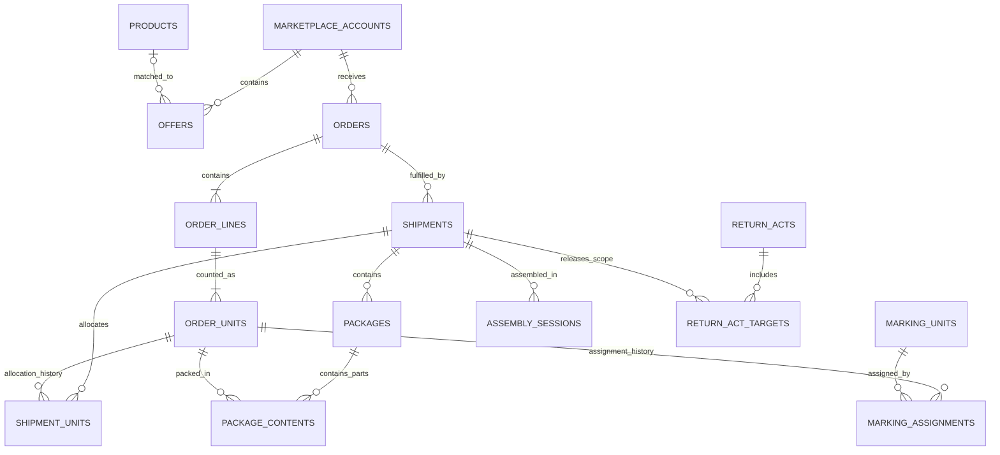

# Данные и границы модулей новой панели

**Статус: основа согласована; начата реализация первого этапа.**

Дата: 21 ноября 2026 года. Основание: версия 1.70.0, коммит
`3286ae31c5db597720bc9fb1aef6f531fa6c6962`.
Ветка: `refactor/modular-architecture`.

Документ описывает целевую модель, а не фактическое устройство старой базы.
Текущая готовность нового каркаса описана в `v2/README.md`; бизнес-операции
переносятся отдельными этапами. Старая панель и её база не изменяются.
Резервная копия по указанию владельца не создаётся.

## 1. Основные решения

1. Одно приложение на Python/FastAPI с самостоятельными бизнес-модулями.
2. Одна PostgreSQL; таблицы имеют владельцев. Веб-приложение и исполнитель
   фоновых заданий — отдельные процессы из одного репозитория.
3. Существующие оформление, формы и согласованные складские правила сохраняются.
   Название модуля не означает отдельную кнопку в меню.
4. Общая модель заказов используется всеми площадками. Их отличия находятся
   в адаптерах API и явно объявленных возможностях.
5. Внутренние ID не зависят от номера заказа, отправления или штрихкода.
6. Начальная область — одна установленная панель, несколько сотрудников,
   кабинетов площадок и рабочих мест. SaaS, несколько независимых организаций,
   финансовый учёт и складские остатки в этот этап не включаются.
7. Автоматический импорт старой базы — отдельная задача после утверждения
   схемы. Старые данные и ключи не удаляются и не преобразуются этим документом.

## 2. Какие сущности различаем

| Сущность | Значение и связи |
|---|---|
| Кабинет площадки | Конкретное подключение Ozon/Яндекса/Avito. У одной площадки может быть несколько кабинетов. |
| Товар | Складская карточка конкретного товара/варианта. Цвет или размер, требующий отдельного учёта, — отдельный товар. |
| Карточка площадки | Предложение в конкретном кабинете: SKU, offer_id, название, фото и коды. Связывается со складским товаром после сопоставления. |
| Заказ | Заказ покупателя на площадке. Может включать несколько отправлений. |
| Позиция заказа | Заказанная карточка, количество, цена и снимок названия на момент заказа. |
| Единица товара | Одна штука позиции. Для количества 2 создаются две единицы; это позволяет различать два ЧЗ. |
| Отправление | Часть заказа, которую площадка обрабатывает как отдельное отправление. У Ozon это posting. Для других площадок может быть одно внутреннее отправление на заказ. |
| Грузоместо | Конкретная коробка внутри отправления. Имеет собственный ярлык/код, когда площадка его предоставляет. |
| Часть единицы | Связь одной единицы товара с коробкой. Один товар может занимать две коробки, сохраняя количество 1 и один ЧЗ. |
| Сессия сборки | Попытка сборщика собрать отправление с определённой ревизией состава. Содержит сканы и прогресс. |
| Экземпляр ЧЗ | Конкретная маркированная единица, определяемая GTIN и серийным номером. |
| Привязка ЧЗ | Текущая или историческая связь экземпляра ЧЗ с единицей заказа. |
| Документ | Стикер, ярлык, дубликат ЧЗ или акт. Получение, хранение и печать — разные действия. |
| Возврат | Сведения площадки о возвращаемом товаре/отправлении, включая частичный возврат. |

Для Ozon общий заказ определяется по фактическому order_id/order_number,
а posting_number остаётся идентификатором отправления. Если площадка не
предоставляет отдельный уровень отправления, создаётся одно внутреннее
отправление, без выдуманного внешнего номера.

Карточка может временно не иметь сопоставленного складского товара. Название,
артикул и состав заказа сохраняются снимком; ошибка сопоставления не должна
привести к исчезновению заказа или случайному объединению товаров.



## 3. Модули и владельцы данных

Названия таблиц ниже — проектные. Это перечень логических данных, не готовый
DDL и не требование создавать все таблицы при первом запуске каркаса.

| Модуль | Его данные | Публичные операции | Чего он не делает |
|---|---|---|---|
| **Пользователи и доступ** (`identity`) | Пользователи, роли, доступ к разделам, сессии | Войти, выйти, проверить разрешение, управлять сотрудниками | Не хранит ключи площадок и не принимает решения о сборке |
| **Интеграции** (`integrations`) | Кабинеты, зашифрованные ключи, состояние синхронизации, внешние операции, защищённые снимки API | Проверить подключение; получить нормализованный ответ; выполнить и проверить внешнюю операцию | Не изменяет таблицы сборки, ЧЗ и заказов напрямую |
| **Товары** (`catalog`) | Складские товары, карточки площадок, их идентификаторы и ШК, состав комплектов | Найти по коду, сопоставить карточки, получить состав комплекта | Не выбирает заказ и не увеличивает собранное количество |
| **Заказы** (`orders`) | Заказы, позиции и единицы, отправления, грузоместа, внешние номера, ревизии состава и статусы площадки | Применить снимок площадки, найти отправление, получить очередь, подготовить/подтвердить раскладку | Не хранит полный ЧЗ и не считает сканы |
| **Сборка** (`assembly`) | Сессии, сканы, проверенные единицы и коробки, резервирование работы | Открыть, принять скан, отменить, завершить; координировать остальные модули | Не содержит HTTP-клиента Ozon и не пишет чужие таблицы |
| **Данные экземпляров** (`instance_data`) | Требования к данным, ГТД/РНПТ/УИН/IMEI/вес, неизменяемые пакеты передачи | Обновить требования, сохранить значения, собрать полный пакет, проверить готовность | Не определяет текущего владельца ЧЗ |
| **Честный знак** (`marking`) | Экземпляры ЧЗ, привязки, история освобождения, результаты передачи кодов | Проверить конфликт, привязать, отвязать, получить данные дубликата и состояние проверки | Не меняет состав заказа и не управляет принтером |
| **Возвраты** (`returns`) | Возвраты, приёмка, акты, точные цели отвязки | Принять, включить в акт, получить состав акта, опубликовать основание освобождения ЧЗ | Не меняет строки маркировки SQL-запросом |
| **Документы** (`documents`) | Оригиналы, связи с отправлениями/грузоместами, контрольные суммы, актуальность, сроки хранения | Сохранить один раз, получить, найти, пометить ярлык неактуальным | Не считает сохранение доказательством печати |
| **Печать** (`printing`) | Профили, принтеры, бумага, задания, попытки и рабочие места | Создать задание, направить клиенту, зафиксировать результат/перепечатку | Не принимает решение о готовности заказа |
| **Отчёты** (`reports`) | Согласованные модели чтения, отчётный день и его отсечка | Показать отчёт, выгрузить CSV/PDF | Не меняет заказы, привязки или результаты сборки |

**Настройки** — общий экран параметров этих модулей. Владельцем параметра
остаётся соответствующий модуль: бумага у печати, ключи у интеграций,
отсечка дня у отчётов, политика обязательности ЧЗ у данных экземпляров.

## 4. Предлагаемые группы таблиц

| Владелец | Основные таблицы и существенные поля |
|---|---|
| Identity | `users`, `user_sections`, `sessions`: внутренний ID, роль, активность, права; пароль хранится хешем |
| Integrations | `marketplace_accounts`, `account_secrets`, `sync_checkpoints`, `remote_operations`, `remote_snapshots`: площадка, кабинет, область API, контрольная точка, тип операции, её статус и ревизия |
| Catalog | `products`, `offers`, `offer_refs`, `product_codes`, `offer_codes`, `product_components`: карточка площадки принадлежит кабинету, коды имеют тип и происхождение, комплект имеет состав |
| Orders | `orders`, `order_lines`, `order_units`, `shipments`, `shipment_units`, `packages`, `package_contents`, `order_refs`, `shipment_refs`, `package_refs`: внутренние связи, внешние ссылки и история распределения единиц |
| Assembly | `assembly_sessions`, `scan_events`, `assembly_unit_checks`, `assembly_package_checks`: сессия, сотрудник, рабочее место, ревизия состава, scan_id и результат каждого действия |
| Instance data | `instance_requirements`, `unit_details`, `submission_batches`: требования по типам полей, значения по единицам, согласованный снимок полного запроса и ссылки на ЧЗ |
| Marking | `marking_units`, `marking_assignments`, `marking_transmissions`: идентичность/исходный код, единица заказа, начало и конец привязки, причина освобождения, точный результат передачи |
| Returns | `returns`, `return_items`, `return_acts`, `return_act_targets`: фактический возврат и количество, акт, разрешённая цель освобождения маркировки |
| Documents | `documents`, `document_links`: тип, источник, размер листа, хеш, содержимое/ключ хранения, срок хранения, ссылка на отправление и при необходимости коробку |
| Printing | `workstations`, `print_profiles`, `print_jobs`, `print_attempts`: тип документа, бумага/принтер, адресат, статус, связь перепечатки с исходным заданием |
| Reports | `shipment_report_rows`, `return_act_report_rows`, `report_settings`: проекции событий/фактов и параметры отчётного дня |
| Инфраструктура | `outbox_events`, `jobs`, `job_attempts`, `command_receipts`, `audit_events`: надёжная доставка, повторы, защита от повторного выполнения, аудит |

У записей, которые меняются, предусмотрены `created_at`, `updated_at` и
`revision`. У связей и действий — автор, причина и идентификатор операции.
Архивирование кабинета/пользователя не удаляет историю каскадно.

### 4.1. Идентификаторы и типы

- Внутренние ID — UUID. Обычные ссылки между таблицами — внешние ключи.
- Внешние номера и коды — строки: сохраняются ведущие нули и исходный регистр.
- Внешняя ссылка содержит кабинет, тип значения, исходное значение и правило
  сравнения. `tracking_number`, posting_number, `ii...` и номер коробки —
  разные типы, даже если все используются для поиска.
- Авторитетный внешний ID сущности уникален в пределах кабинета и своего
  типа. Сканируемые псевдонимы не предполагаются глобально уникальными:
  неоднозначность обрабатывается явно.
- У заказа и отправления нет зависимости первичного ключа от печатного номера.
- Денежные суммы — точные десятичные числа с валютой; количества — целые
  положительные числа; время — UTC с часовым поясом. Московская отсечка дня
  применяется отчётами при расчёте отчётной даты.

### 4.2. Отправления, грузоместа и количество

`shipment_units` задаёт, какие единицы входят в отправление. В один момент
единица может принадлежать не более чем одному действующему отправлению;
нераспределённая единица допустима только в явном черновике/при сверке.

`package_contents` задаёт части этих единиц в коробках. Две штуки товара —
две единицы. Один товар в двух коробках — одна единица с двумя частями,
например 1/2 и 2/2. Проверки принадлежности, количества частей и полноты
раскладки выполняет модуль заказов. ЧЗ остаётся один, на единице товара.

При разделении Ozon создаются новые отправления и сохраняется связь с
исходным. При изменении коробок Яндекса отправление может остаться тем же.
Перенос единиц подтверждается фактическим ответом площадки; до подтверждения
раскладка имеет статус черновика/ожидания.

Номера экземпляров площадки относятся к текущему отправлению и ревизии:
после разделения их нужно перечитать. Внутренняя единица остаётся стабильной.
При неоднозначном распределении одинаковых товаров соответствие ЧЗ новым
отправлениям подтверждается данными площадки, а не порядком строк.

При удалении разделения на площадке выполняется сверка: прежняя раскладка
помечается устаревшей, обновляются действующие связи и доступные ярлыки.
Синхронизация не оставляет старые коробки доступными для текущей печати.
Старые ссылки сохраняются для поиска истории.

### 4.3. Штрихкоды и сопоставления

Складской товар объединяет карточки только через явное/проверенное
сопоставление. Совпадение цифр само по себе не объединяет карточки.
Каталог сначала ищет точный код, затем разрешённые варианты конкретного типа.
При нескольких разных товарах возвращается неоднозначность.

GTIN, OZN, MRKT, собственный ШК и коды комплектующих имеют тип и происхождение.
GTIN для проверки ЧЗ берётся из подтверждённых данных товара/карточки;
из OZN/MRKT нельзя механически выделять цифры и объявлять их GTIN.
Неизвестный GTIN — отдельное состояние, а не доказательство несовпадения.

## 5. Требования к данным и Честный знак

### 5.1. Требования отдельно от введённых значений

Для каждой требуемой характеристики хранятся:

- источник и время получения;
- область: отправление, позиция или единица;
- ответ площадки: обязательно / необязательно / не применяется / неизвестно;
- правило панели и версия этого правила;
- итоговая обязательность и ограничения значения.

Сохраняем действующую договорённость: доступный необязательный ЧЗ
(`is_mandatory_mark_possible`, `CIS_OPTIONAL`) также требуется панелью.
Это политика панели; исходное значение API не переписывается в «обязательно».
ГТД запрашивается отдельным полем **«Указать ГТД»** под товаром, когда требуется.

Требования перечитываются при открытии сборки и перед критическими действиями
в обоих рабочих статусах. Ошибка 403/таймаут не превращается в «данные не нужны».
Чтение требований и право изменять их — разные возможности адаптера.

### 5.2. Идентичность, текущая связь и передача

У `marking_units` хранятся GTIN, серийный номер, отпечаток идентичности и
зашифрованный полный код. Исходные данные не обрезаются; GS и криптохвост
обрабатываются проверенным разборщиком. Для API транспортная сериализация
выполняется адаптером, включая корректный JSON без двойного экранирования GS.

`marking_assignments` хранит единицу заказа, время привязки, время/причину
освобождения и ревизию. Текущая связь определяется единственным правилом:
`released_at IS NULL`. История не перезаписывается при повторном использовании.

Ограничения базы:

1. Один экземпляр ЧЗ — не более одной текущей привязки во всей установке.
2. Одна маркируемая единица заказа — не более одного текущего ЧЗ этого типа.
3. Повтор того же scan_id не создаёт новую привязку.
4. Несовпадающие полные данные не считаются одинаковыми только по совпадению
   отпечатка идентичности; конфликт требует явной проверки.

`marking_transmissions` относится к конкретной привязке и пакету передачи.
Идентичность кода, его занятость и принятие площадкой — разные факты.
Полные коды, ключи и содержимое защищённых пакетов не попадают в обычный журнал.

При конфликте показываем согласованное сообщение:
**«Данный Честный знак уже используется в заказе: {номер}»**.

### 5.3. Передача ЧЗ и других данных

Модуль данных экземпляров собирает неизменяемый `submission_batch`: полный
состав запроса, поля единиц, ссылки на привязки ЧЗ и ожидаемые ревизии состава,
раскладки и значений. ЧЗ предоставляет свой снимок через публичный интерфейс.

ГТД и ЧЗ остаются отдельными операциями ввода и отдельными результатами
проверки. Если API требует отправить полный набор экземпляров, адаптер получает
согласованный общий пакет. Старый ответ не подтверждает новые значения.

HTTP 200 означает только тот результат, который определён контрактом метода.
Для асинхронных методов нужен последующий опрос/сверка. При сетевой неопределённости
сначала проверяется фактический результат; слепой повтор сборки запрещён.

«М»: серый — скан/проверка ещё не завершены; красный — отказ; зелёный —
площадка подтвердила текущую привязку/ревизию. Отдельные индикаторы в интерфейс
сборки этим проектом не добавляются. Ожидание внешней операции отображается
как загрузка, а не как ошибка сканирования.

### 5.4. Освобождение и возвраты

Сохраняем правило версии 1.70.0: **все ЧЗ сборочного заказа, включённого в акт,
освобождаются по акту**, без дополнительного подтверждения акта или отметки
«Принят». Даже при частичном возврате фактическое количество возврата
сохраняется отдельно от этой политики освобождения.

Область освобождения фиксируется в `return_act_targets` по внутренним ID.
Под «заказом» в текущем складском процессе Ozon понимается конкретное
отправление. Включение одного posting в акт не освобождает автоматически ЧЗ
соседних отправлений того же покупательского заказа. Для площадки с одним
отправлением на заказ эта область совпадает с заказом.

Возвраты фиксируют акт и событие/сохранённое задание в одной транзакции.
Маркировка получает точные ID и ревизии прежних привязок; освобождение
синхронное через публичную службу либо гарантированно повторяемое заданием.
Старая задача не освобождает новую привязку того же ЧЗ.

Ручная отвязка — привилегированная операция администратора/владельца с аудитом.
Автоматическая проверка отмен Ozon остаётся отдельной политикой по
подтверждённым данным площадки. Освобождение внутри панели не приравнивается
к возврату товара в оборот в системе ЧЗ; прямую интеграцию с ней не добавляем.
История в «Стикерах» показывает **«Отвязан»**.

## 6. Состояния и последовательность сборки

| Объект | Пример состояний |
|---|---|
| Состояние площадки | Исходные status/substatus + нормализованное состояние + время сверки |
| Сессия сборки | Открыта → сканирование → дополнительные данные → ожидание площадки → проверка ярлыков → завершена; отдельно отменена |
| Внешняя операция | Запланирована → отправляется → проверяется → подтверждена / отклонена / результат неизвестен |
| Пакет данных экземпляров | Собирается → поставлен в очередь → проверяется → принят / отклонён / неизвестен |
| Задание печати | Создано → передано клиенту → клиент принял / ошибка / результат неизвестен; физическое выполнение зависит от транспорта |

Реальные состояния и переходы уточняются при описании команд. Таблица
показывает разделение фактов; её не следует превращать в одну общую колонку.

```text
Скан товара или стикера
  → API: пользователь, права, command_id / scan_id
  → сборка: найти или открыть сессию
  → заказы / каталог: определить отправление и единицу
  → данные экземпляров: получить актуальные требования
  → скан товара, затем ЧЗ нужной единицы / ввод ГТД
  → сохранить привязки, прогресс и необходимые задания
  → адаптер: передать полный набор и проверить результат
  → заказы: подтвердить фактическую готовность и раскладку
  → документы: получить актуальные ярлыки
  → печать / скачивание на рабочем месте
  → сборка: проверить условия завершения
```

Последовательность внешних вызовов зависит от схемы работы и возможностей
площадки. Готовое на площадке отправление повторно в сборку не отправляется.

Один пользователь имеет не более одной активной сессии. Одно отправление
имеет не более одной действующей брони сборки; срок аренды и ревизия защищают
от двух сборщиков и запоздалых запросов.

Сканер на клиенте использует последовательную очередь. Повтор HTTP с тем же
scan_id возвращает прежний результат, а новый scan_id с тем же ШК считается
следующим сканом. Для ЧЗ выбирается конкретная ожидающая единица после скана
товара; неоднозначность и несовпадение GTIN не решаются случайным выбором.

Отмена сессии не считается автоматическим разрешением освободить принятый
площадкой ЧЗ. Сначала учитываются подтверждённые данные и правила отвязки.

## 7. Стикеры, печать и рабочие места

1. Документы сохраняют оригинальный стикер один раз для соответствующего
   актуального ярлыка. Повтор синхронизации не создаёт его версии.
2. Изменение реальной раскладки/идентичности ярлыка создаёт новый объект ярлыка;
   прежний помечается неактуальным для текущей сборки. Разделение не печатает
   старый родительский стикер вместо подтверждённых дочерних.
3. Архив оригинальных стикеров — шесть календарных месяцев. Очистка PDF не
   удаляет текущие привязки ЧЗ, внешние номера и требуемую историю операций.
4. Поиск поддерживает номера отправления, `ii...`, GTIN и полный ЧЗ. Поиск
   полного кода использует модуль маркировки и проверку исходных данных.
5. Серверное сохранение и скачивание на компьютер — отдельные события.
   Скачивание начинается при открытии сборки, когда актуальный ярлык доступен;
   иначе — после передачи данных и подтверждения готовности.
6. Выбор локальной папки выполняется браузером/приложением и хранится в контексте
   рабочего места. Строка пути на сервере не даёт доступа к папке сборщика.
7. Дубликат ЧЗ запускается согласованной галочкой после успешного локального
   принятия и сохранения скана, без ожидания остальных кодов и завершения сборки.
   Передача полного пакета выполняется, когда собраны нужные значения.
   Зелёная «М» появляется только после подтверждения площадки.
8. Для дубликата ЧЗ — один общий профиль принтера для всех маркетплейсов.
   Отдельные назначения ЧЗ для Ozon и Яндекса не создаются. В начальной версии
   сохраняется общая настройка панели; модель рабочих мест определяет адресата
   задания и готовит основу для ТСД.
9. Печать ШК перед стикером остаётся отдельной галочкой: приоритет коду данной
   площадки OZN/MRKT, затем подходящим остальным кодам, затем собственному коду
   сопоставленного товара; при отсутствии ШК дополнительный лист не печатается.
10. Сервер хранит задание, клиент печатает через QZ Tray/браузер. Для Android
    потребуется совместимый транспорт конкретного Wi-Fi-принтера.

Получение файла, его скачивание, принятие задания клиентом и фактический выход
бумаги не считаются одним событием. При неопределённом результате нет слепой
автоматической перепечатки; повторное задание связано с исходным и видно в аудите.

## 8. Правила взаимодействия модулей

- Модуль записывает свои таблицы. Другие вызывают его публичные команды.
  Прямой SQL в чужие таблицы и импорты внутренних файлов запрещаются проверками.
- Обычные операции в одном приложении — вызовы Python-служб. Внутренний HTTP
  между модулями не нужен.
- Критические изменения нескольких модулей допускаются одной транзакцией
  через публичные службы и общий Unit of Work. Сетевые запросы выполняются
  после фиксации транзакции, без длительного удержания блокировок базы.
- Событие/задание создаётся в одной транзакции с изменением данных. Исполнитель
  использует аренду, ожидаемую ревизию, ограниченные повторы и проверку результата.
  Доставка допускает повтор; обработчик не повторяет уже применённое действие.
- У команды есть ID, пользователь/рабочее место, целевой объект и ожидаемая
  ревизия. У результата — выполнено / ожидается / отклонено / конфликт / неизвестно.
- События содержат внутренние ID и безопасные сведения. Полные коды и секреты
  передаются ссылкой на защищённые данные, а не открытым JSON в общей очереди.
- Адаптер площадки не импортирует другой адаптер и не решает, какой заказ
  выбрать сборщику. Он выполняет контракт и возвращает нормализованный результат.
- Отчёты читают проекции или согласованные представления; отставание проекции
  не определяет доступность ЧЗ и не разрешает завершение сборки.

Основание строки отчёта об отгрузке сохраняется: сборщик зачёл товар из
состава отправления. Открытие окна и один переход статуса площадки не создают
такую строку. Повторная доставка того же факта не удваивает количество;
ошибки сканирования учитываются отдельными фактами.

Примеры публичных команд: `orders.find_shipment`, `orders.apply_snapshot`,
`catalog.resolve_code`, `assembly.accept_scan`, `instance_data.save_details`,
`marking.assign`, `marking.release`, `returns.include_in_act`,
`documents.ensure_label`, `printing.enqueue`.

## 9. Структура проекта и подключение возможностей

```text
app/
  bootstrap/          # регистрация модулей, адаптеров, API и исполнителей
  shared/             # ID, ошибки, часы, контекст; без правил площадок
  modules/
    identity/
    catalog/
    orders/
    assembly/
    instance_data/
    marking/
    returns/
    documents/
    printing/
    reports/
  integrations/
    common/           # контракты, подключения, операции, синхронизация
    ozon/
    yandex/
    avito/
  infrastructure/     # PostgreSQL, транзакции, задания, криптография, аудит
  web/                # существующий стиль, шаблоны и клиентская логика
migrations/
tests/
```

Для сложного модуля: `public.py` с командами/результатами, `domain.py` с
правилами, прикладные службы, репозиторий, запросы для чтения и тонкий API.
Количество файлов определяется сложностью; пустые слои заранее не создаются.

Новая площадка реализует доступные контракты: каталог, чтение заказов,
требования экземпляров, передача, подтверждение готовности, раскладка,
ярлыки и возвраты. Допустимые действия зависят от схемы FBS/rFBS/DBS,
статуса и возможностей API. Единая модель не обещает операции, которой
площадка не предоставляет. Точные методы/версии фиксируются и проверяются
отдельно при реализации адаптера, а не выводятся из макета интерфейса.

## 10. Что считается согласованием этого этапа

Предлагается согласовать следующие решения:

1. Заказ, отправление, грузоместо и единица товара — разные сущности с
   внутренними ID; внешние номера хранятся отдельными ссылками.
2. Модули и владельцы данных — как в таблице раздела 3. Настройки объединяют
   параметры модулей, не становятся владельцем всех бизнес-данных.
3. ЧЗ принадлежит единице товара; текущая привязка, история и принятие
   площадкой представлены отдельно. ЧЗ не дублируется из-за двух коробок.
4. Требования площадки и более строгое правило панели хранятся раздельно.
   ГТД и ЧЗ — отдельный ввод с согласованным общим пакетом, когда его требует API.
5. Действующие правила интерфейса, печати и освобождения по актам сохраняются;
   отдельные возможности площадок проверяются контрактами адаптеров.
6. Одна PostgreSQL и отдельный фоновый исполнитель; важные операции не теряются
   при перезапуске, повтор запроса не удваивает действие.

После согласования: точные поля и ограничения первого набора таблиц,
миграции PostgreSQL, каркас приложения, авторизация и регистрация модулей.
Первый законченный сценарий — подключить один кабинет, синхронизировать
каталог и заказы, отобразить их в сохранённом стиле.

Критерии последующей реализации: установка на пустую базу, проверка прав,
изоляция кабинетов, совпадение состава и количества, сохранность полных кодов,
защита от двойной привязки, от старых ответов и повторных заданий, корректная
сверка разделения, отсутствие дублирующей печати при сетевом повторе.
